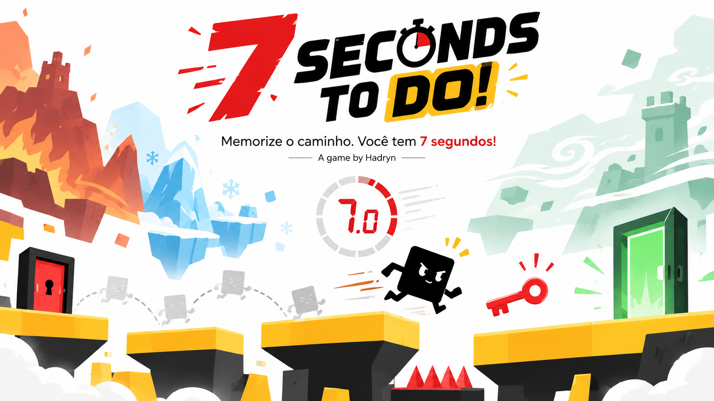

# 7 Seconds to Do!

**Memorize the path. You have 7 seconds!**

**An independent game developed by Hadryn**

[**Play on GitHub Pages**](https://hadryndev.github.io/7-seconds-to-do/)

## 🎮 About the Game

**7 Seconds to Do!** is an independent platform game that combines **memorization, quick thinking, precision, and time-based challenges**.

In each level, first explore the environment and memorize the obstacles. During the challenge, find the **red key**: once collected, you have **exactly seven seconds** to reach the door!

Missed it? Try again. Attempts are unlimited, and each attempt is a chance to learn the route.

## 🕹️ How to Play

Each level has two mandatory stages:

1. **Presentation:** explore and memorize the route without a timer.
2. **Challenge:** find the red key to start the seven-second countdown and reach the green door.

If time runs out, the door closes, the key respawns at its original location, and the character stays in place.

### Controls

| Action | Keys |
|---|---|
| Move | A / D or ← / → |
| Jump | W, ↑, or Space |
| Restart stage | R |
| Return to menu | Esc |

## 🚀 Current Version

**Alpha v0.0.4_7 — approved integrated build**

The current version includes:

- **Two original levels:** *Zigzagging* (formerly *Zigue-Zagueando*) and *Parkour*;
- **A new long third level:** *The Gauntlet*, 150 tiles wide;
- Presentation and Challenge stages for all three levels;
- A strict **7-second** timer after collecting the key;
- Unlimited attempts;
- Responsive movement and full mid-air control;
- A fixed jump height of approximately six tiles;
- **Coyote time** and **jump buffering**, improving jumps near platform edges;
- Solid platforms, refined collisions, and precise door contact;
- A **dynamic horizontal camera** with directional look-ahead and smoothed changes of direction;
- **Moving platforms:** horizontal platforms and vertical elevators;
- **Gravity Platforms** that start falling when stepped on;
- **Patrol enemies:** blue enemies can be stomped; red enemies are fatal on contact;
- Support for **variable-width levels**, keeping the height at 20 tiles;
- A menu with settings, credits, and an in-game changelog.

### Run Locally

1. Download the repository's **index.html** file.
2. Open it in a modern browser.
3. Click **Start** (currently displayed as **Iniciar** in the game).

No additional software is required.

**GitHub Pages:** https://hadryndev.github.io/7-seconds-to-do/

> The current in-game interface is in Brazilian Portuguese. Repository documentation is maintained in English. Further game languages are planned.

## 🗺️ Vision for the Full Game

The [Game Design Document (GDD)](docs/GDD.md) outlines:

- **30 levels in 6 worlds**, with 5 levels per world;
- Themed worlds, including proposed **fire, ice, and wind** environments;
- Moving and collapsing platforms, traps, teleporters, and dash;
- Puzzles involving hidden keys and routes;
- A geometric protagonist with expressions and small animations;
- Dynamic music and retro / 8-bit sound effects;
- Progress saving, personal records, medals or stars, and rankings;
- **Brazilian Portuguese, English, and Spanish**;
- **Free distribution**, without ads or mandatory purchases.

**These are plans:** these features are not yet all available in the current Alpha.

Target platforms include **Web/HTML5, Windows, Android, and consoles**, with gradual expansion. The design target for the full campaign is **30–60 minutes**.

## 🔒 Meet Keyla (Planned for Alpha v0.1.0)

**Keyla** is the officially approved name and concept of the future protagonist: a living padlock who collects a key to unlock the exit. Her name stays **Keyla** across Brazilian Portuguese, English, and Spanish. The full character artwork, expressions, animations, and visual redesign are reserved for **Alpha v0.1.0 — The Great Update**. The current game continues to use its original **16 × 16 px black square** player and collision box.

## 🧰 Technology

- **HTML5**
- **CSS**
- **JavaScript**
- **Canvas 2D**

The prototype runs directly in a browser without mandatory external dependencies.

## 📝 Development and Version History

The project uses incremental Alpha build numbers to record changes.

- **Alpha v0.0.4_5:** refined physics, collisions, jump reliability, and control responsiveness.
- **Alpha v0.0.4_6:** dynamic camera and expanded levels.
- **Alpha v0.0.4_7:** approved integrated build featuring *The Gauntlet*, moving platforms, falling Gravity Platforms, and enemies. Includes the restored turbo trail and a cleaner in-game HUD.

For details, see [CHANGELOG.md](CHANGELOG.md) and [GitHub Releases](https://github.com/hadryndev/7-seconds-to-do/releases).

## 👤 Credits

**Creation, concept, and direction:** Hadryn  
**Prototype development:** Hadryn, with assistance from ChatGPT.

The goal is to publish **7 Seconds to Do!** as Hadryn's first independent game and document its evolution as a development and portfolio project.

---

**7 Seconds to Do!**  
*Memorize the path. You have 7 seconds!*

